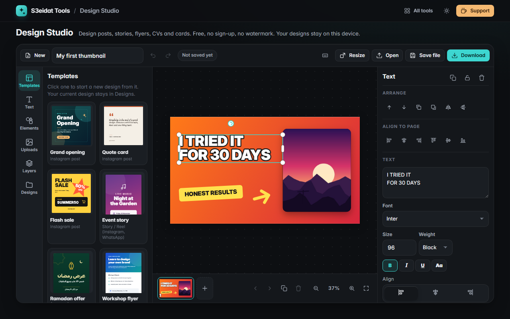

# Design Studio

> Design social posts, stories, flyers, CVs, business cards and thumbnails. Free, private, no sign-up, no watermark, and it runs entirely in your browser.

### ▶ [Open Design Studio](https://s3eidat.github.io/design-studio/)



A free, local-first alternative to online design tools like Canva, for the everyday jobs: a post, a flyer, a CV, a card.

## Features

- **14 original templates** to start from (posts, stories, an Arabic story, flyer, CV, YouTube thumbnail, two-sided business card, LinkedIn banner, slides, certificate, menu, invitation) and **20 size presets**, or any custom size in px, mm or inches
- **Text** with any font installed on your device, your own font files (.ttf, .otf, .woff, .woff2), **Arabic and right-to-left** text, bold/italic/underline/uppercase, alignment, line and letter spacing, outline, highlight, gradients
- **Images** from your device (drop, click or paste), image frames you fill by dropping a photo on them, fill/fit/stretch, corner radius, brightness, contrast, saturation, black and white, blur
- **Shapes** (rectangle, ellipse, triangle, diamond, pentagon, hexagon, star, arrow, heart), **lines** (dashed, dotted, arrow heads) and **59 icons** drawn for this project
- Select, move, resize and rotate with handles; **multi-select**, **snapping guides** to the page and other objects, **align and distribute**, **group / ungroup**, z-order, lock, hide, flip, opacity, shadows
- **Layers panel** with drag to reorder, **multiple pages**, **undo / redo**, zoom and pan (mouse, trackpad, pinch), keyboard shortcuts (press `?`)
- **Resize a design** to any other size, in place or as a copy, with the content scaled to fit
- **Download PNG** (with transparent background if you want), **JPG** (quality slider), at 0.5x to 4x or at a print DPI, **PDF** (one page or all pages, A4 and other paper sizes in real millimetres, Latin text stays selectable), or **all pages as a .zip**
- **Autosave** in this browser (IndexedDB) and a "Designs" list; **save and open `.s3design` project files** to back up or move a design. Opened files are validated field by field before use

## Limits

- PDF pages are high-resolution images; only Latin text gets an invisible, selectable copy (Arabic is in the image).
- No stock photo library, AI tools, background remover, animation, video or real-time collaboration.
- Fonts are the ones on your device or the files you load; a project file carries your uploaded fonts, not device fonts.

## Privacy

Your designs, images and fonts never leave your device. There is no server, no account and no analytics.
The page ships with a strict Content-Security-Policy (`connect-src 'self'`), so the browser itself blocks
any attempt to send data anywhere. Designs are stored only in this browser until you save a file.

## Run it yourself

It's plain HTML, CSS and JavaScript with no build step:

```bash
git clone https://github.com/s3eidat/design-studio
cd design-studio
python -m http.server 8000
```

Then open http://localhost:8000. PDF export uses [pdf-lib](https://github.com/Hopding/pdf-lib) (MIT) and zips use [JSZip](https://github.com/Stuk/jszip) (MIT), both shipped in `lib/`.

## Support

If this saved you time, **[buy me a coffee ☕](https://s3eidat.github.io/coffee/)**. It keeps every tool free.

---

Part of **[S3eidat Tools](https://s3eidat.github.io/)**: 100+ free, private tools that run in your browser. MIT licensed.
